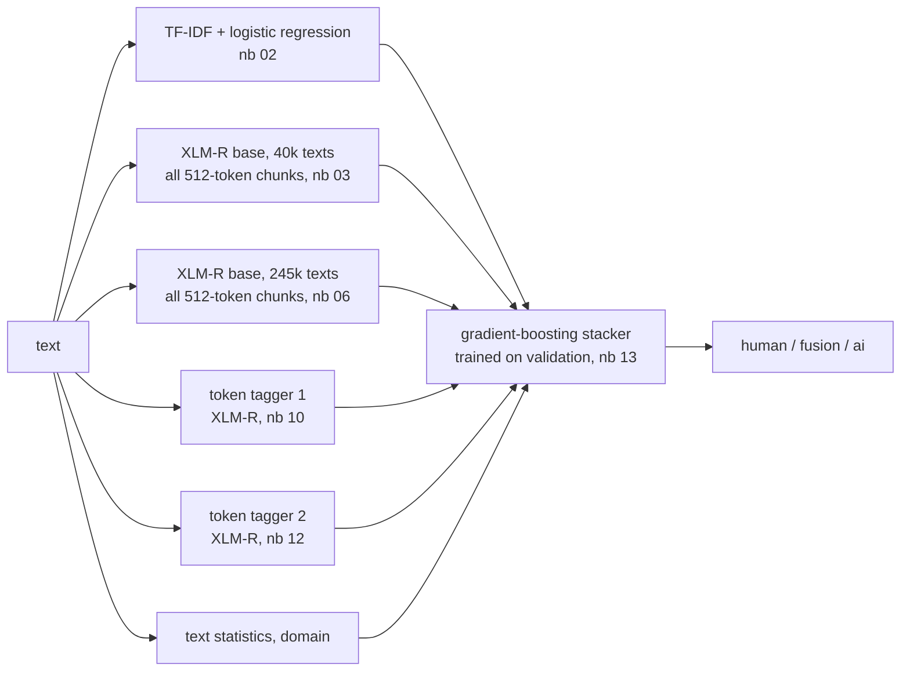

# AI-generated text detection (UCU AI 2026, HW3)

Code for the Kaggle competition
[`ai-generated-text-detection-hw3-ucu-ai-2026`](https://www.kaggle.com/competitions/ai-generated-text-detection-hw3-ucu-ai-2026):
classify English and German texts as `human`, `ai` or `fusion` (a human text with AI-written sections); metric
macro-F1.

**Final submissions:** `submissions/stack_final.csv` (notebook 13) and `submissions/stack_tagger.csv` (notebook 11).

## Final model



- **Encoders** (XLM-RoBERTa base, fine-tuned): every text is cut into 512-token chunks; each chunk gets class
  probabilities; per text the mean and the first chunk's probabilities are kept, plus the "chunk shape": highest ai
  and fusion, lowest and highest human probability over the chunks, and the number of chunks.
- **Token taggers**: the same network with a label per token (AI-written or not), trained on the AI sections of
  training fusion texts recovered by a word diff with their human sources (notebook 08). Their per-token
  probabilities are summarized per text (longest AI run, smoothed maximum, sentence-level means, ...).
- **Stacker**: `HistGradientBoostingClassifier` on 80 features, trained on the validation set (which no base model
  saw) with out-of-fold scoring over 5 group folds; 5 bagged copies.

## Results

Validation = fold 0 of a group split of `train.csv` (27,236 texts; a human text and its ai/fusion versions stay on
one side), scored with test-like domain weights (notebook 01).

| notebook | model | validation macro-F1 | public LB |
|---|---|---|---|
| 02 | TF-IDF word + char n-grams, logistic regression | 0.866 | 0.869 |
| 03 | XLM-R base, 40k texts, mean over all chunks | 0.899 | 0.893 |
| 04 | linear stacker on 02 + 03, domain, length | 0.918 | 0.920 |
| 06 | XLM-R base, 245k texts | 0.936 | 0.935 |
| 09 | gradient-boosting stacker, both encoders, chunk shape, style | 0.964 | 0.964 |
| 11 | + token tagger features | 0.967 | 0.968 |
| **13** | **+ finer tagger features, second tagger, tuned and bagged boosting** | **0.972** | **0.971** |

Notebook 14 explains the final model (token probabilities on example texts, SHAP values of the stacker). Every run's
metrics are in `results/experiments.csv` and `results/runs/<run>/metrics.json`.

## How to run

### Setup (Mac / Linux)

```bash
git clone https://github.com/anna-kryvulia/ucu-ai-hw-generated-text-detection.git
cd ucu-ai-hw-generated-text-detection
python3 -m pip install -r requirements.txt torch jupyter
```

The competition data is downloaded into `data/` by the first cell of every notebook (Kaggle API: needs
`~/.kaggle/kaggle.json` and the competition rules accepted), or can be put there by hand (`train.csv`, `test.csv`,
`sample_submission.csv`). Notebooks run from the `notebooks/` folder:

```bash
python3 -m jupyter nbconvert --to notebook --execute --inplace notebooks/02_baseline.ipynb
```

### Order

Run the notebooks in order; each one reads the saved predictions of the earlier ones from `outputs/runs/`
(git-ignored: checkpoints and predictions are too large for the repo). Times are measured on a MacBook Air (M-series)
and a Kaggle T4 GPU.

| notebook | where | time | needs | produces |
|---|---|---|---|---|
| 01_eda | Mac | 25 min | data | findings; `results/split.csv.gz` (groups, validation fold, test-like weights) |
| 02_baseline | Mac | 56 min | 01 | TF-IDF model, `submissions/baseline_tfidf.csv` |
| 03_encoder | Kaggle T4 | 1.4 h | 01 (in git) | XLM-R on 40k texts, chunk probabilities |
| 04_approach | Mac | 1 min | 02, 03 | class weights, blend, linear stacker |
| 05_pairs | Mac | 9 min | data | pair check in test (negative result) |
| 06_encoder_full | Kaggle T4 | 5.5 h | 01 (in git) | XLM-R on 245k texts, chunk probabilities |
| 07_stack_features | Mac | 8 min | 02, 03 | chunk-shape, seam and style features, first boosting stacker |
| 08_fusion_spans | Mac | 4 min | data | `results/fusion_spans.csv.gz` (AI sections of training fusion texts) |
| 09_stack_full | Mac | 4 min | 02, 03, 06 | `submissions/stack_full.csv` |
| 10_tagger | Kaggle T4 | 2 h | 08 (in git) | token tagger 1, per-text tagger features |
| 11_stack_tagger | Mac | 1 min | 02, 03, 06, 10 | `submissions/stack_tagger.csv` (final submission 2) |
| 12_tagger2 | Kaggle T4 | 3 h | output of 10 attached | token probabilities of tagger 1, token tagger 2 |
| 13_stack_final | Mac | 30 min | 02, 03, 06, 10, 12 | `submissions/stack_final.csv` (final submission 1) |
| 14_xai | Mac | 5 min | 02, 03, 06, 10, 12 | explanations (figures in `images/xai_*.png`) |

GPU time in total is about 12 hours on a T4; the Mac notebooks take about 2.5 hours.

### Kaggle notebooks (03, 06, 10, 12)

1. Push the repo to GitHub (the first cell clones it and installs `requirements.txt`).
2. On Kaggle: *New Notebook* from the competition page (the data is attached), *File → Import Notebook* with the
   `.ipynb`, turn on **GPU T4** and **Internet**.
3. Notebook 12 only: *Add Input → Your Work →* the saved version of notebook 10 (it needs the first tagger's
   `model.pt`).
4. *Save Version → Save & Run All*. When it is done, download its outputs and copy them into the local runs:

```bash
kaggle kernels output <user>/<kaggle-notebook> -p ~/Downloads/kaggle-run --file-pattern "^outputs/"
```

```bash
rsync -a ~/Downloads/kaggle-run/outputs/runs/ outputs/runs/
```

```bash
PYTHONPATH=src python3 scripts/collect_results.py --src ~/Downloads/kaggle-run/outputs
```

A run that stops (Kaggle time limit) resumes from its last epoch checkpoint: attach the saved version's output as
an input of the next session and run again.

### Submit

```bash
kaggle competitions submit -c ai-generated-text-detection-hw3-ucu-ai-2026 -f submissions/stack_final.csv -m "stack_final"
```

## Repository layout

| path | contents |
|---|---|
| `notebooks/` | the 14 notebooks above, executed with outputs |
| `src/hwkit/` | shared code: environment and paths (`env.py`), configs, run tracking, validation split and scores (`split.py`), stacker features (`stack.py`, `final.py`), fusion sections (`spans.py`), token tagger (`tagger.py`) |
| `configs/experiments/` | one YAML config per run; `base:` inherits another config |
| `results/` | small committed results: `experiments.csv`, per-run configs and metrics, `split.csv.gz`, `fusion_spans.csv.gz` |
| `submissions/` | every submitted CSV |
| `images/` | figures |
| `scripts/` | `collect_results.py` (Kaggle outputs into `results/` and `images/`), `status.py`, `clean_notebook.py` |

`WORKFLOW.md` describes the run tracking and the Mac / Kaggle / Colab setup in more detail.

## External code, models and data

- Pretrained `xlm-roberta-base` (Conneau et al., 2020) via Hugging Face `transformers`; no external data, only
  `train.csv`.
- scikit-learn (TF-IDF, logistic regression, `HistGradientBoostingClassifier`, `StratifiedGroupKFold`), SHAP
  (Lundberg & Lee, 2017) for notebook 14.
- Ideas: token-level boundary detection as in SemEval-2024 Task 8, subtask C (Wang et al., 2024); dataset:
  GhostWriter (Schaaf, Bönisch, Mehler, LREC 2026).
- Code written with the help of Claude (Anthropic) as a coding assistant; the report is written without AI tools.
