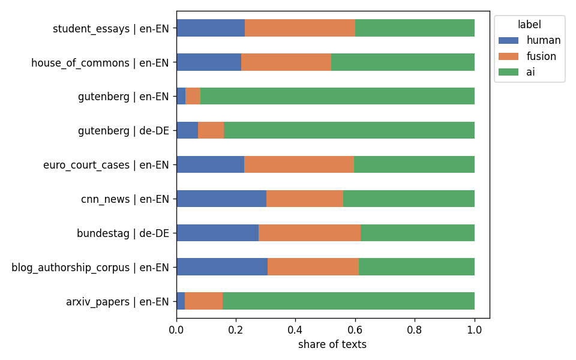
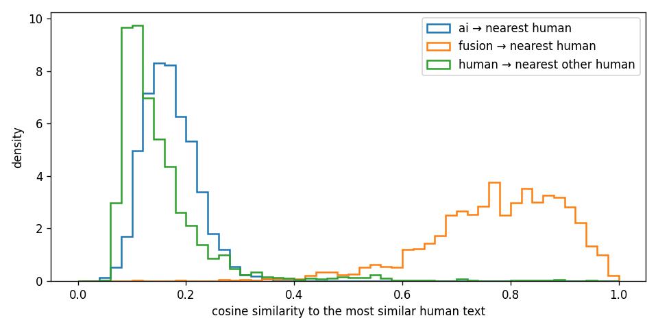
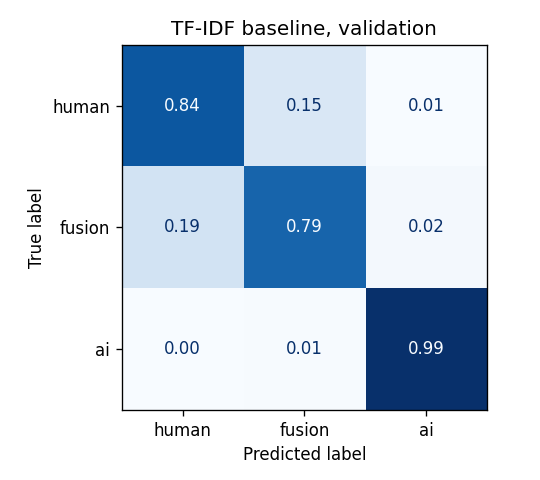
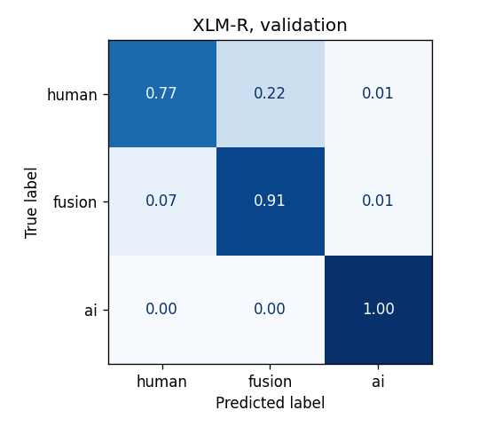
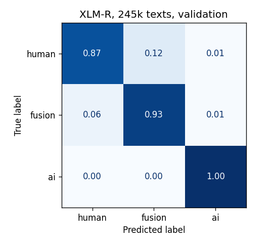
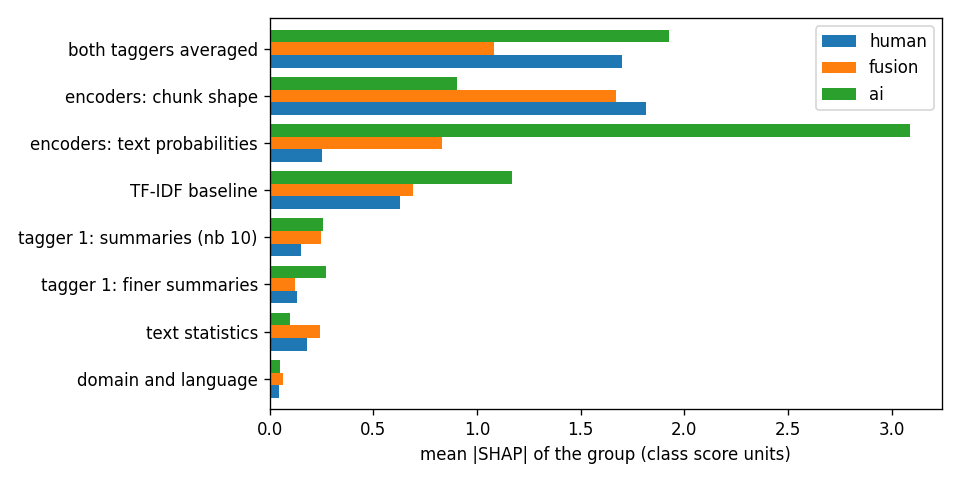
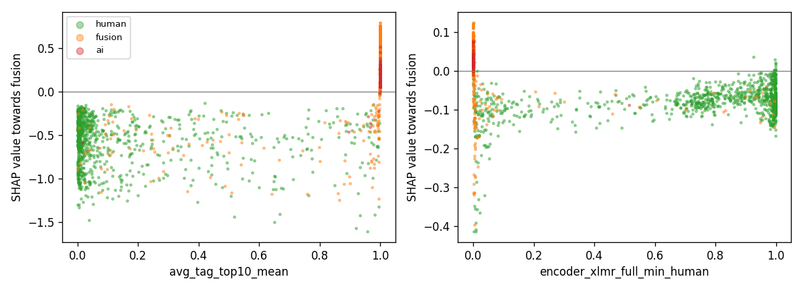
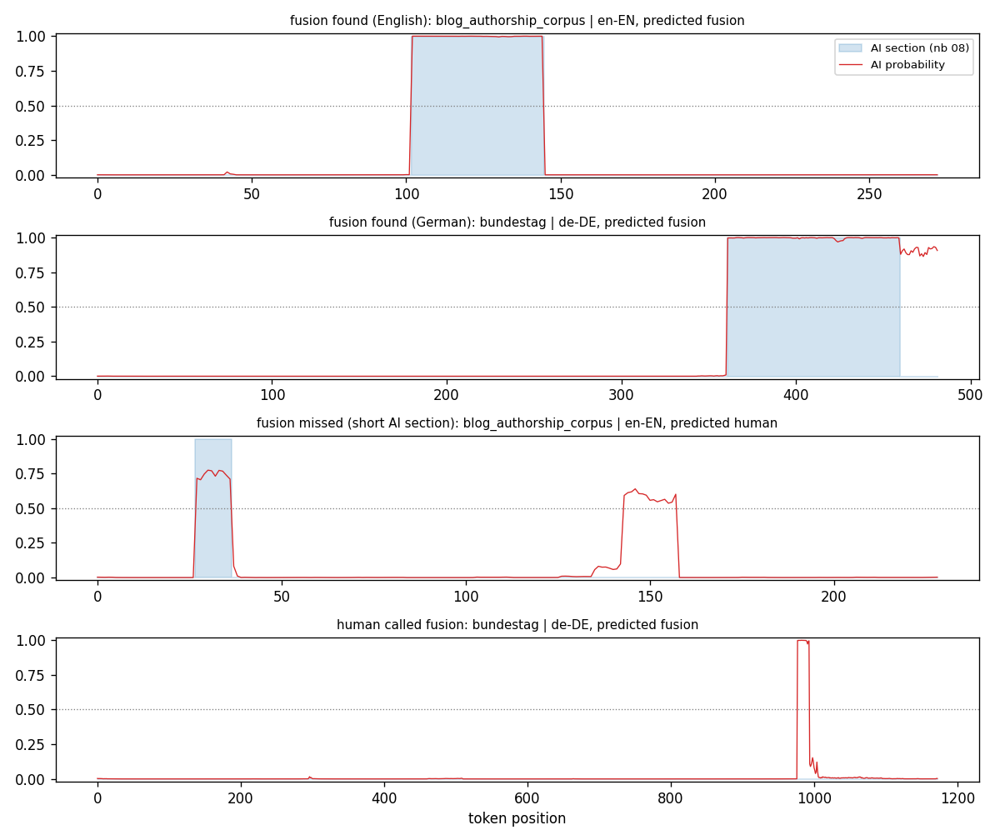
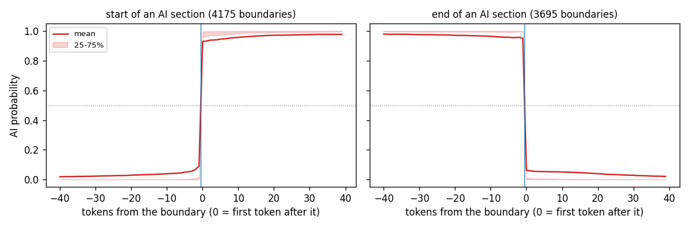

# AI-generated text detection (UCU AI 2026, HW3)

Anna Kryvulia, repo: <https://github.com/anna-kryvulia/ucu-ai-hw-generated-text-detection>

**Final submissions:** `submissions/stack_final.csv` and `submissions/stack_tagger.csv`
Best private score: 0.96831 (`stack_final.csv`, public 0.97074)

## 1. Data and EDA

The training set - 272,352 texts: ai - 45%, fusion - 31%, human - 25%
The metric is macro-F1, so the class human (smallest one) counts as much as the largest one. 81% of the training texts are English and 19% German, in test 85% - English, 15% - German
The 8 domains have different shares in train and test. Test has about 2.8 times more English Gutenberg
texts. Texts are 20-3000 words long (with median 463), and 62% are longer than 512 tokens, so a
transformer that reads only the beginning misses most of a long text. In arXiv, Gutenberg and court cases, human and
fusion texts are much longer than ai ones, so there from a length alone we can get the label

Fusion is a complicated class: a human text in which usually one section (in 64% of the texts) was rewritten by an LLM.
The median fusion text has only 22% AI words, and its TF-IDF similarity to its source is 0.79. So fusion is a local
property: the model has to find a small AI part somewhere in a mostly human text

## 2. Validation

A human text and its ai and fusion versions are always on the same side of the train/test split, but train set
has no group column. Related texts in both train and validation would make the score too optimistic. I rebuilt the
groups with TF-IDF cosine similarity: an ai or fusion text is linked to the most similar human text of its domain if
the similarity is at least 0.4, two human texts if at least 0.5, and linked texts form a group. Fold 0 of 10
stratified group folds (27,236 texts) is the validation set. Each validation text is weighted so that the domain mix
matches test, and models are compared on this weighted macro-F1. For all 7 submissions it was within 0.006 of both the
public and the private score, and the order of the models was the same, so I made every choice on validation, not on the public leaderboard

## 3. Baseline: TF-IDF and linear models

I used TF-IDF on words (1-2 words) and characters (3-5 letters). On the fixed 40k sample I tried words, characters
and both, with Naive Bayes, linear SVM and logistic regression (C = 2, 8, 32). The best was logistic regression on
both with C = 32 (0.854); on 80k texts it got 0.866 on validation and 0.869 on the public leaderboard. ai is easy
(F1 about 0.985). Almost all mistakes are between human and fusion: 15% of human texts were predicted as fusion and
19% of fusion texts as human. The domain as a feature did not help (-0.001)

## 4. Encoder: fine-tuned XLM-RoBERTa

I fine-tuned XLM-RoBERTa base, a multilingual model, so one model works for both languages. It reads only 512
tokens at once, so I cut texts into 512-token chunks. In training it sees one random chunk of each text per epoch;
in prediction it reads all chunks and I average their probabilities. On the same split and 40k texts it got 0.899,
the baseline 0.854. Reading all chunks instead of the first one gave +0.039 (+0.11 for texts with 5+ chunks),
because the AI part can be anywhere. With 245k texts (5.5 hours on a T4 GPU) it got 0.936. The main mistakes are
still human against fusion

## 5. Own experiments

I saved validation and test predictions of every model, so each experiment changes one thing against a fixed
reference without retraining (see the tables)

- **Class weights (did not work).** The best weights were the same for human and fusion: moving the border between
  them fixes as many mistakes as it makes.
- **Blending and stacking.** The average of XLM-R and TF-IDF gave +0.008, as they make different mistakes. A stacker
  (a second model on the predictions of other models) with the domain and length got 0.918.
- **Pairs in test (did not work).** Comparing a text with its human source is easier than judging it alone, but
  only 0.7% of test texts have such a copy.
- **Chunk shape and gradient boosting.** Fusion is local, so I added the highest fusion and lowest human probability
  over the chunks. With gradient boosting this gave 0.940, and 0.964 with both encoders. Formatting traces gave only
  +0.001.
- **Token tagger.** In notebook 08 I found the AI words of each training fusion text by comparing it with its human
  source. I trained XLM-R to label every token as AI or human and made per-text features from its probabilities
  (for example the longest AI part). Added to the stacker they gave 0.967.
- **Finer tagger features and a second tagger.** Missed fusion texts have only 2.6% AI words (median), lost in a
  32-token average. Shorter windows and sentence averages gave +0.003, a second tagger averaged with the first
  +0.004, a small boosting search 0.9718. Random features moved the score up to 0.0008, so gains below 0.002 are
  noise.

| notebook | experiment | reference, then result (validation, test-like macro-F1) |
|---|---|---|
| 04 | class weights for macro-F1 | 0.899 to 0.899 (did not work) |
| 04 | average of XLM-R and TF-IDF | 0.899 to 0.907 |
| 04 | linear stacker with domain and length | 0.899 to 0.918 |
| 05 | pairs inside test | did not work: only 0.7% of test texts have a near copy |
| 07 | gradient boosting + chunk shape + formatting and style | 0.918 to 0.940 (formatting and style alone +0.001) |
| 09 | gradient boosting stacker with both encoders | 0.964 |
| 10, 11 | + token tagger features | 0.964 to 0.967 |
| 12, 13 | + finer tagger features, second tagger, tuned and bagged boosting | 0.967 to 0.972 |

| notebook 13 variant | validation, test-like macro-F1 |
|---|---|
| reference (notebook 11 features) | 0.9672 |
| + finer features of tagger 1 | 0.9699 |
| + averaged taggers | 0.9710 |
| + both | 0.9712 |
| best grid setting (300 trees, learning rate 0.05, 31 leaves) | 0.9718 |
| 5 bagged copies (final) | 0.9718 |

## 6. Final model and how to run it

The final model is a gradient boosting stacker (5 averaged copies) on 80 features from TF-IDF, both encoders, both
taggers, text statistics and the domain. The base models are trained on folds 1-9; the stacker
is trained on their predictions for fold 0 (27,236 texts they never saw), scored with 5 group folds inside fold 0:
0.9718 (F1 human 0.958, fusion 0.965, ai 0.998), and then refit on all of fold 0 to predict test. The second submission, `stack_tagger.csv`
(notebook 11), has no tuning: a safe option if the tuning overfit validation. `README.md` lists the notebooks in
order with commands (about 12 GPU hours on Kaggle and 2.5 hours on a Mac).

| notebook | model | validation macro-F1 | public LB | private LB |
|---|---|---|---|---|
| 02 | TF-IDF, logistic regression | 0.866 | 0.869 | 0.860 |
| 03 | XLM-R base, 40k texts | 0.899 | 0.893 | 0.894 |
| 04 | linear stacker | 0.918 | 0.920 | 0.916 |
| 06 | XLM-R base, 245k texts | 0.936 | 0.935 | 0.933 |
| 09 | gradient boosting stacker | 0.964 | 0.964 | 0.960 |
| 11 | + token tagger (`stack_tagger.csv`) | 0.967 | 0.968 | 0.964 |
| 13 | final (`stack_final.csv`) | 0.972 | 0.971 | 0.968 |

## 7. Explainability

In notebook 14 I explain the final model on two levels.

First, the token tagger: its probability for each token shows which words look AI-written. At about 4,000 starts of
AI parts the probability jumps from 0.09 to 0.93 at the first AI token, and at the ends falls from 0.95 to 0.06, so
the border is found almost exactly. In human texts less than 1% of words are marked as AI, mostly abstract political
words in German speeches, references in arXiv papers and quotes in another language.

Second, the stacker, with SHAP (how much each feature pushed a prediction towards a class). The taggers get 27% of
the total effect, chunk shape 25%, encoder probabilities 24%, TF-IDF 14% and the domain 1%. ai is decided by the
style of the whole text, human vs fusion by "is any part not human?". The dependence plot shows why short AI parts
are missed: the stacker moves to fusion only when the tagger is almost sure (near 1), because medium values were
mostly false alarms in training. So the tagger has to be more sure on short AI parts.

